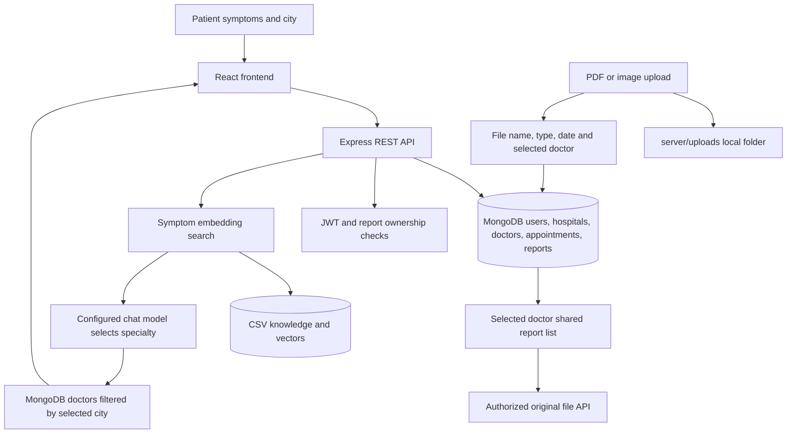

# BookMyAppointment AI

## Project Overview

BookMyAppointment AI helps patients find care, book appointments, upload original medical reports, and share those files with a selected doctor. Report files are stored and transferred without automated reading or modification.

## Problem

Patients may need a simpler way to find care, book a suitable appointment, and get their original reports to the doctor they choose.

## Objectives

- Let patients upload original reports and share them with a selected doctor.
- Suggest a specialist to consider from symptoms.
- Make it easier to discover nearby hospitals, departments and doctors.
- Let patients book, review and cancel appointments.
- Give doctors and hospital administrators role-specific tools for schedules and report workflows.
- Protect sensitive reports with authentication, role checks and patient-controlled sharing.

## How We Built It

1. Built a responsive React frontend with Vite, Tailwind CSS and React Router.
2. Created a modular Node.js and Express REST API.
3. Implemented password hashing, JWT sessions and role-based authorization.
4. Added Patient, Doctor and Hospital Admin roles.
5. Added city-based hospital and doctor discovery with specialty filters.
6. Added a CSV-backed symptom knowledge base with generated embeddings and RAG-based specialist suggestions.
7. Added validated PDF, JPG, JPEG and PNG report uploads.
8. Store each uploaded file unchanged in the local `server/uploads/` folder.
9. Let a patient select a doctor during upload; the report is shared with that doctor immediately.
10. Added protected APIs for doctors to list, view and download reports shared with them.
11. Implemented appointment booking with server-side availability checks and duplicate-slot protection.
12. Hospital and doctor listings are loaded from MongoDB; project startup never inserts demo catalog or accounts.

## Architecture



## Main Features

- Patient, Doctor and Hospital Admin sign-in and role-aware navigation.
- Patient dashboard with upcoming visits and uploaded reports.
- City selection and hospital/doctor list discovery.
- Symptom retrieval over a CSV knowledge base; matching doctors are loaded from MongoDB for the selected city.
- Doctor specialties, hospital association, fees, ratings and available slots.
- Appointment booking, confirmation, history and cancellation.
- A persistent, appointment-linked conversation between the patient and assigned doctor, including report attachments and doctor messages.
- Patient report upload for PDF, JPG, JPEG and PNG.
- Upload original report files and share them with a selected doctor.
- Doctors can view and download original report files shared with their provider account.
- Hospital discovery and appointment booking require the connected MongoDB database.

## User Roles

### Patient

Register or sign in, set a city, find doctors, request a specialist suggestion, upload reports directly to a selected doctor, and manage appointments.

### Doctor

Review assigned appointments, see booked visits, update appointment status and exchange messages or reports with patients in the appointment conversation. Appointment times are generated automatically.

### Hospital Admin

Manage hospital doctor/department records, review hospital appointments and exchange messages or reports with patients in appointment conversations. Appointment times are generated automatically.

## Report Upload and Sharing

A patient chooses a doctor and uploads a PDF or image. The backend writes the original file to `server/uploads/` and stores its metadata and sharing permission in MongoDB. It does not run OCR, extract values, summarize, or modify the file. The selected doctor can use the authenticated report APIs to view the report record and retrieve the original bytes. Patients and doctors can preview uploaded images in the app; PDFs can be downloaded for review.

## Appointment Booking

The daily schedule is generated automatically from 9:00 AM to 6:00 PM in 15-minute slots, with a 1:00–2:00 PM lunch break. The last appointment starts at 5:45 PM and ends at 6:00 PM. Doctors and admins do not enter availability manually. Patients see open times; once a patient books a time it is withheld from other patients. The API checks for an active booking and MongoDB's unique active-slot index prevents simultaneous duplicate bookings. Cancelling or completing an appointment releases its slot. Booking and discovery return an unavailable response instead of switching to in-memory demo data when MongoDB is disconnected.

Project startup never inserts demo hospitals, doctors, appointments, or accounts. The legacy demo seed script remains available only as an explicit opt-in for an isolated database: set `ENABLE_DEMO_SEED=true` in `server/.env` and run `npm run seed --prefix server`. Do not enable it in your real development database.

## Location

Patient location can be changed in Settings or from the location selector in the header. Available locations are derived from real, non-sample hospital records. When a global admin adds a hospital in a new city, that city appears automatically in patient location settings, doctor discovery and symptom recommendations. Google Maps geocoding and automatic current-location discovery are not configured.

## Medical Reports

Patient reports are uploaded as original files and shared with the selected doctor during upload. Files are stored locally in `server/uploads/`; Cloudinary is not used by the upload flow. Access to the file endpoint requires authentication and report ownership or explicit sharing. Doctors see patient reports shared with their provider account.

## Symptom RAG

The project root contains `symptom-knowledge.csv` (editable symptom descriptions) and `symptom-knowledge-embedded.csv` (the generated vectors). Run Ollama locally, pull the configured chat and embedding models, then run `npm run embed:symptoms --prefix server` to create or refresh vectors in the embedded CSV. The symptom API embeds each query with the same local embedding model, retrieves matching rows, and asks the local chat model to choose only from those specialty candidates. It then returns matching MongoDB doctors from the patient's selected city. No cloud model API is used. If Ollama is unavailable, the app falls back to local keyword matching.

```bash
ollama pull llama3.2
ollama pull nomic-embed-text
npm run embed:symptoms --prefix server
```

## Technology Stack

| Layer | Technology |
|---|---|
| Frontend | React 18, Vite, Tailwind CSS, React Router, Axios |
| UI and charts | Lucide React, Recharts |
| Backend | Node.js, Express |
| Database | MongoDB, Mongoose (required for hospital discovery and bookings) |
| Authentication | JWT, bcryptjs |
| Uploads | Multer; local `server/uploads/` storage |
| Location | Manual city selection; optional location provider can be added |

## API Documentation

All routes use the `/api` prefix. Except health, city/hospital/doctor discovery and auth, routes require `Authorization: Bearer <JWT>`.

| Method | Route | Access | Purpose |
|---|---|---|---|
| GET | `/health` | Public | API and storage mode status |
| GET | `/cities` | Public | Distinct cities from registered non-sample hospitals |
| POST | `/auth/register` | Public | Register a patient |
| POST | `/auth/register-global-admin` | Public, first account only | Create the first global admin with the configured setup key |
| POST | `/auth/login` | Public | Sign in and receive a JWT |
| GET / PUT | `/users/profile` | Signed in | Read or update own profile |
| POST | `/symptoms/recommend-specialist` | Signed in | RAG symptom recommendation and doctors in requested city; JSON body: `{ "symptoms": "...", "city": "Guntur" }` |
| GET | `/hospitals?city=` | Public | Search non-sample hospitals |
| GET | `/hospitals/:id` | Public | Hospital details and associated doctors |
| POST | `/hospitals` | Hospital Admin | Add a hospital |
| GET | `/doctors?city=&specialty=` | Public | Search non-sample doctors |
| GET | `/doctors/:id` | Public | Doctor details |
| GET | `/doctors/:id/availability?date=` | Public | Available slots |
| POST | `/doctors/:id/availability` | Disabled | Returns `410`; availability is automatic |
| POST | `/doctors` | Hospital Admin | Add a real doctor profile and create its doctor login account |
| POST | `/appointments` or `/appointments/book` | Patient | Book a slot |
| GET | `/appointments` | Signed in | Own or assigned appointment history |
| GET | `/appointments/:id` | Related user | Appointment details |
| POST | `/appointments/:id/cancel` | Related user | Cancel appointment |
| GET / POST | `/appointments/:id/messages` | Appointment patient / assigned doctor | Read or send persistent conversation messages; completed appointments remain available, while cancelled threads are read-only |
| PATCH | `/appointments/:id/status` | Doctor / Hospital Admin | Confirm, complete or cancel |
| POST | `/reports/upload` | Patient / Doctor | Upload an original report (`report` field); in an appointment chat, include `appointmentId` and optional `message` to attach it to that conversation |
| POST | `/reports/:id/upload` | Doctor / Hospital Admin | Upload for an assigned patient |
| GET | `/reports` | Signed in | Patient’s own reports or provider’s uploaded/shared reports |
| GET | `/reports/shared-with-me` | Doctor / Hospital Admin | Reports patients have shared with this provider |
| GET | `/reports/user/:userId` | Patient / authorized provider | Patient report history |
| GET | `/reports/:id` | Owner / uploader / shared provider | Read report metadata |
| GET | `/reports/:id/file` | Owner / uploader / shared provider | Read original file |
| POST | `/reports/:id/share` | Report owner | Grant report access to a provider account |
| DELETE | `/reports/:id/share/:userId` | Report owner | Revoke provider access |
| POST | `/ai/recommend-specialist` | Signed in | Specialist suggestion |

## Database Collections

- **Users** — account credentials (hashed), role, patient profile and provider links.
- **Doctors** — specialty, hospital, experience, fee and rating. Daily appointment slots are generated from schedule settings, not stored per doctor.
- **Hospitals** — address, city/state, coordinates, departments and contact details.
- **MedicalKnowledge** — optional text-only educational content; symptom vectors are stored in the root CSV, not MongoDB.
- **MedicalReports** — owner/uploader, optional appointment link, original file metadata and explicit sharing list.
- **AppointmentMessages** — persistent patient/doctor conversation messages and links to appointment report attachments.
- **Appointments** — patient, doctor, hospital, date/time, status and active-slot key.

## Environment Variables

Copy `server/.env.example` to `server/.env`. The symptom RAG uses Ollama locally and needs no cloud API key.

- `PORT`, `CLIENT_URL`, `MONGODB_URI`, `JWT_SECRET`, `JWT_EXPIRES_IN`, `ADMIN_SIGNUP_KEY`, `MAX_UPLOAD_MB`
- Optional schedule settings: `APPOINTMENT_START_TIME=09:00`, `APPOINTMENT_END_TIME=18:00`, `APPOINTMENT_LUNCH_START=13:00`, `APPOINTMENT_LUNCH_END=14:00`, `APPOINTMENT_SLOT_MINUTES=15`.
- `OLLAMA_BASE_URL`, `OLLAMA_CHAT_MODEL`, `OLLAMA_EMBEDDING_MODEL`, `OLLAMA_REQUEST_TIMEOUT_MS`, `OLLAMA_AUTO_EMBED`
- Optional `ENABLE_DEMO_SEED=true` and `DEMO_PASSWORD` to seed fictional records in an isolated demo database. Demo seeding is off by default.
- Optional frontend `VITE_API_URL` in `client/.env` (defaults to `http://localhost:5000/api`)

## Installation

For a fresh checkout, use [LOCAL_SETUP.md](LOCAL_SETUP.md) for the full setup, environment values, account setup and commands. Requirements are Node.js 20+ and npm, reachable MongoDB for persistent storage, and Ollama for semantic symptom retrieval. Without MongoDB, persistent accounts, report metadata, bookings and provider discovery are unavailable.

```bash
# from the repository root
npm install --prefix server
npm install --prefix client
npm install

# If setting up a fresh checkout, create local environment files from the examples:
cp server/.env.example server/.env
cp client/.env.example client/.env

# start API and frontend together
npm run dev
```

Frontend: `http://localhost:5173`  
Backend health: `http://localhost:5001/api/health` for this workspace's local configuration. The default backend port is 5000.

To run separately:

```bash
npm run dev --prefix server
npm run dev --prefix client
```

Local `server/.env` and `client/.env` files are ignored by Git; create them from the checked-in examples and add your MongoDB URI to enable persistent accounts and listings. Demo seeding is disabled by default; the app reads provider cities, hospitals, and doctors from the connected database and shows no listings until real provider records exist.

### Account setup

Public registration creates patient accounts only. To create the first global admin from the app, set a private `ADMIN_SIGNUP_KEY` in `server/.env` and ensure `MONGODB_URI` points at the intended database. Open the app's sign-in page (`http://localhost:5173/login`), choose **Set up first global admin**, and provide the setup key, name, email, and password. The app permits only one global admin signup per database. After signup, use the normal sign-in form with that email and password; the account role is loaded from MongoDB. The existing `npm run admin:create --prefix server` command remains available as an optional local bootstrap method.

After signing in, open the admin dashboard. Add the hospital first with its real name, address, city, and any optional details. Then use **Doctors & specialties** to select that hospital and create each real doctor. Each doctor entry needs a unique login email and a temporary password (at least 8 characters); the system creates both the doctor profile and its `DOCTOR` login. Share that login with the doctor securely so they can sign in through the same page. The default appointment schedule is available automatically for every registered doctor. Only real provider records appear in city search and symptom recommendations.

Existing records marked as sample data are hidden from the app and are not reinserted at startup. They are separate documents already present in MongoDB; see the setup note after this section before removing them.

Demo accounts ending in `@bookmyappointment.demo` are rejected by sign-in. Demo catalog seeding is disabled unless explicitly enabled for an isolated database.

## Running the Frontend

The Vite client is started by `npm run dev --prefix client`. The default API URL is `http://localhost:5000/api`; set `VITE_API_URL` in your private `client/.env` if you run the API on another port. A backend and MongoDB connection are required for report uploads and sharing.

## Running the Backend

Start the API using `npm run dev --prefix server`. Copy `.env.example` to `server/.env` and set a strong `JWT_SECRET` before exposing the service beyond a local demo. MongoDB persistence is enabled when `MONGODB_URI` is configured.

## Render Demo Deployment

The root `render.yaml` defines a single Render web service that builds the React client and serves it from the Express API. The client uses same-origin `/api` requests, and the service exposes `/api/health` as its health check. Connect this repository to Render as a Blueprint, then provide the MongoDB connection string when prompted; Render generates the JWT secret. Production startup refuses to run without a reachable MongoDB database and a JWT secret.

The Blueprint selects Render's Free plan for a capstone demo. Free services can sleep when idle and have ephemeral local filesystems, so this setup is not suitable for real patient data. Report uploads are stored in `server/uploads/` on the service. This folder is suitable for local development; hosted filesystems may be ephemeral and can lose uploads during a restart or redeploy.

## Running Locally

Start Ollama before using semantic symptom recommendations. The configured local models are `llama3.2:3b` and `nomic-embed-text:latest`; setup commands are in [LOCAL_SETUP.md](LOCAL_SETUP.md). Existing symptom vectors are already in the root `symptom-knowledge-embedded.csv`, so embedding generation is only needed after changing the source `symptom-knowledge.csv`. Start the API and frontend with `npm run dev`, then open `http://localhost:5173` and check `http://localhost:5000/api/health` (or the port in your `server/.env`). Report files are written to `server/uploads/`; MongoDB stores the report metadata and doctor-sharing permission. Report uploads do not use AI or cloud storage.

## Folder Structure

```text
client/
  src/components/       Shared navigation and modal components
  src/data/             Unused legacy client demo data
  src/pages/             Patient/provider views
  src/services/          API client
  src/App.jsx             Routes and app state
  src/styles.css          Responsive product styling
server/
  src/ai/                 Specialist suggestion rules (legacy analysis modules are unused)
  src/config/             Database connection
  src/controllers/        REST request handlers
  src/data/               Opt-in fictional seed records
  src/middleware/         JWT, errors and role checks
  src/models/             Mongoose schemas
  src/routes/             REST route definitions and upload validation
  src/services/           Hybrid persistence and file storage adapters
  uploads/                Protected local report files
README.md
.env.example
```

## Future Scope

- More report formats and lab-specific range configuration.
- Hospital EMR integration and provider onboarding/verification.
- Wearable data and patient-authorized integrations.
- Real-time appointment availability, notifications and calendar integration.
- Google Maps geocoding and current-location discovery.
- Production-grade audit logs, encryption/key management and consent history.

## Known Limitations

- Fictional seed records are opt-in and are not loaded in the default application flow.
- Without MongoDB, the app has no hospital/doctor listings; provider records must be present in MongoDB.
- Local report uploads are stored on the server filesystem. Hosted deployments need persistent storage to retain files across restarts.
- Maps integration is not configured.
- This capstone starter is not production-certified for handling real patient data; a deployment needs security, privacy, regulatory and clinical review.

## Safety Disclaimer

"This application stores and shares uploaded medical documents. It does not provide a medical diagnosis or replace a licensed healthcare professional."
